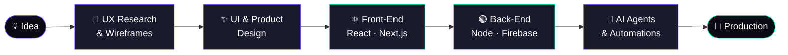

<!--
  Palette:  Violet #7C5CFF  ·  Mint #00E5A8  ·  Ink #0B0B14
-->

<div align="center">


<a href="https://git.io/typing-svg">
  
</a>

<br/>


<br/><br/>

<a href="https://www.behance.net/nasmir1"></a>
<a href="https://www.upwork.com/freelancers/~012456382034bb8991"></a>
<a href="mailto:annasamir122@gmail.com"></a>

</div>

<br/>

## 👋 Hey, I'm Anas Amir

I'm an **AI Product Engineer** who covers the whole product lifecycle alone: **research → UI/UX → front-end → back-end → AI agents → deployment.**

Most teams need a designer, a developer and an automation engineer to ship one product. I do all three, so nothing gets lost in handoff and the product feels like one coherent system.

```ts
const me = {
  role: "AI Product Engineer",
  experience: "2+ years",
  designs: ["Mobile Apps", "Websites", "Product / SaaS UI"],
  builds:  ["Web Apps", "APIs", "Autonomous AI Agents", "Automation Workflows"],
  philosophy: "Beautiful on the surface. Intelligent underneath.",
  delivers: "Complete end-to-end solutions, idea to production",
};
```

<br/>

## 🧭 How I Work — End to End



<br/>

## 🛠️ What I Offer

<table>
<tr>
<td width="33%" valign="top">

### 🎨 Design
Mobile app design, website design and product / SaaS UI, built on user flows, design systems and clean prototypes that developers can build from directly.

</td>
<td width="33%" valign="top">

### ⚛️ Build
Fast, responsive web apps with **React & Next.js**, backed by **Node.js & Firebase**. Typed, scalable and production-ready.

</td>
<td width="33%" valign="top">

### 🤖 Automate
Autonomous **AI agents**, multi-agent workflows and business automations that handle the repetitive work end to end.

</td>
</tr>
</table>

<br/>

## ⚡ Tech Stack

### 🎨 UI / UX & Product Design
<p>
  
</p>

> **Figma** · **Adobe Illustrator** · **Adobe XD** · **Photoshop**

### 🌐 Web Development
<p>
  
</p>

> **React** · **Next.js** · **Tailwind CSS** · **JavaScript** · **TypeScript** · **Node.js** · **Firebase**

### 🤖 AI Agents & Automation
<p>
  
  
  
  
  
</p>

### 🧬 Modern Agentic AI Toolkit
Concepts and tools I use to build autonomous systems that work in the real world:

<p>
  
  
  
  
  
  
  
  
  
  
  
  
</p>

<br/>

## 🚀 Featured Work

> 💡 Replace each card with a real project. Screenshots go in the repo's `assets/` folder (see the comment above each card).

<table>
<tr>
<td width="50%" valign="top">

<!-- Add screenshot: save as assets/project-1.png then remove the comment markers -->
<!--  -->

### 🤖 Project One — AI Agent System
*Autonomous multi-agent workflow that does X so teams save Y hours.*

`CrewAI` `LangGraph` `n8n` `Python`

**What I did:** Designed the UX, built the dashboard and engineered the agent pipeline.

[🔗 Live Demo](#) · [💻 Code](#)

</td>
<td width="50%" valign="top">

<!-- Add screenshot: save as assets/project-2.png then remove the comment markers -->
<!--  -->

### 📱 Project Two — Mobile App
*Product design to prototype for a [type] app with a clean, conversion-focused flow.*

`Figma` `Illustrator` `Prototyping`

**What I did:** Research, wireframes, UI kit and a clickable prototype.

[🔗 Case Study](#) · [🎨 Figma File](#)

</td>
</tr>
<tr>
<td width="50%" valign="top">

<!-- Add screenshot: save as assets/project-3.png then remove the comment markers -->
<!--  -->

### 🌐 Project Three — Full-Stack Web App
*A responsive SaaS-style web app from design to deployment.*

`Next.js` `TypeScript` `Tailwind` `Firebase`

**What I did:** UI design, front-end, auth, database and deployment.

[🔗 Live Demo](#) · [💻 Code](#)

</td>
<td width="50%" valign="top">

<!-- Add screenshot: save as assets/project-4.png then remove the comment markers -->
<!--  -->

### ⚙️ Project Four — Business Automation
*Automated workflow connecting CRM, email and AI to cut manual work.*

`n8n` `LangChain` `Webhooks` `APIs`

**What I did:** Mapped the process, built the workflow and added AI decision steps.

[🔗 Case Study](#) · [💻 Workflow](#)

</td>
</tr>
</table>

<br/>

## 🔭 Currently

| | |
|---|---|
| 🧠 **Exploring** | Production-grade multi-agent systems with LangGraph and MCP |
| 🎯 **Building** | An end-to-end AI product, from interface to autonomous backend |
| 📚 **Learning** | Agent evaluation, observability and reliable human-in-the-loop design |
| 🤝 **Open to** | Freelance projects on Upwork, startup collabs and full-stack AI product roles |

<br/>

## 📊 GitHub Stats

<div align="center">


</div>

<br/>

## 🎯 Where to See My Work

<table>
<tr>
<td width="33%" valign="top">

### 🎨 Behance
Design case studies: mobile apps, websites and product UI, with the full process behind each.

[View my designs →](https://www.behance.net/nasmir1)

</td>
<td width="33%" valign="top">

### 💼 Upwork
Delivered client projects and reviews, and the place to hire me directly.

[View my profile →](https://www.upwork.com/freelancers/~012456382034bb8991)

</td>
<td width="33%" valign="top">

### 💻 GitHub
Code for my web apps, AI agents and automations, added as I publish each project.

[Browse my repos →](https://github.com/AnssAmir?tab=repositories)

</td>
</tr>
</table>

<div align="center">


</div>

<br/>

## 🤝 Let's Build Something

<div align="center">

**Have an idea that needs a designer, a developer and an AI engineer? I'm all three.**

<a href="mailto:annasamir122@gmail.com"></a>
<a href="https://www.upwork.com/freelancers/~012456382034bb8991"></a>


</div>
